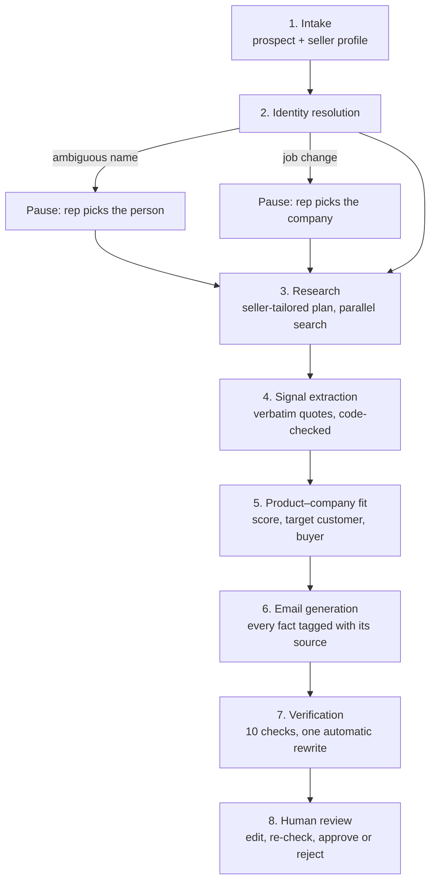

# ProspectIQ

**Evidence-backed B2B outreach, from prospect to draft.**

A sales rep names a prospect. ProspectIQ researches the company, decides whether and why the seller's product genuinely fits, writes a short email grounded in what it found, checks every claim, and hands the draft to the rep for review. Nothing is ever sent automatically.

Built for the Zamp AI Solutions Analyst case study, problem statement 3 (personalised outreach).

- **Live app:** [https://prospectiq-ai-tjsyeimhqcvznqmwydqxvn.streamlit.app/](https://prospectiq-ai-tjsyeimhqcvznqmwydqxvn.streamlit.app/)
- **Demo video (5 min):** _add your Loom link here_

---

## The problem

An SDR working 200 prospects can't spend 20 minutes researching each one, so they send templates, and reply rates show it. The signal that would make an email worth reading is usually public: news, hiring, funding, launches, interviews. The hard part isn't finding text about a company. It's judging **which development gives this particular seller a genuine reason to write**, and saying it without inventing anything.

So ProspectIQ is built around one question, not around email generation:

> *Of everything we know about this company, what gives this seller an honest, specific reason to reach out, and is it strong enough to send at all?*

## How it works

Eight stages, run by a plain Python orchestrator. Each stage has one job, saves its output, and reports progress to the live view. Edge cases branch off at specific checkpoints rather than being buried in a prompt.



| Stage | What it does |
|---|---|
| 1. Intake | Validates the request and the seller profile (no LLM call, so it's instant) |
| 2. Identity | Confirms the person and company. Corrects names and titles from sources; pauses on an ambiguous name or a job change |
| 3. Research | A fast model writes a research plan tailored to what the seller solves, then searches run in parallel. Pages that never mention the company are dropped |
| 4. Extraction | Pulls business signals with a **verbatim evidence quote**; code checks each quote really appears on the page. Removes pages about a different organisation with a similar name |
| 5. Fit | The core. Maps signal → likely pain → seller capability → outcome; scores it; checks the target customer and the buyer; recommends **send, redirect or don't send** |
| 6. Email | Writes from the fit thesis. Answers the reader's three questions: why me, why care, why respond |
| 7. Verification | Code checks, then an AI fact-checker (a different provider when available). Failing drafts are rewritten once, then shown to the rep with the reasons |
| 8. Review | The rep edits and re-checks, tries the runner-up angle, approves, or rejects with a reason |

## Design decisions

**1. The LLM proposes; code checks.** Wherever something can be checked exactly, it is, and the UI says openly when code overrides the AI:

- An evidence quote must appear verbatim on its source page, or the signal is discarded.
- A source URL the model cites must be a real search result.
- A matched capability must exist in the seller's profile, or that angle's fit is capped at 2.
- A pain phrased as a hypothetical ("if…", "might…") is capped at 2.
- A job change claimed without a source is downgraded to "unverified."

**2. Grounding without a vector database.** One run collects 15–30 sources, which fits comfortably in context, so RAG would add a stage, latency and a failure point without making anything more grounded. Instead, every signal carries a verbatim quote, every email claim carries a source ID or seller-profile field, and both are verified. A vector store becomes worthwhile at a different scale, such as researching an account across hundreds of documents.

**3. Fit is scored, and each score says where it came from.**

`S = 0.35·Fit + 0.30·Business impact + 0.20·Freshness + 0.15·Evidence quality`

- **Fit** and **Business impact** need judgment, so the model rates them on anchored 1–5 rubrics.
- **Freshness** (halving every 120 days) and **Evidence quality** (from source type) are computed in code.

A strong verdict also requires the company to match the seller's target customers. Below a threshold, ProspectIQ recommends **not sending** at all.

**4. Honest about weak cases.** A weak fit produces a question-led email labelled "low personalisation," plus a "don't send" recommendation. A prospect who doesn't own the pain gets a redirect suggestion ("better sent to the CFO"). An unverifiable person gets company-level research, never invented personal details.

**5. Human in the loop, by design.** Nothing is sent. Rep edits become new versions and can be re-checked, and approving over failing checks is recorded. Rejection reasons are collected on the dashboard, separating wording problems (the prompts) from prospect problems (the research or the seller profile).

**6. Any provider.** One `generate_structured()` function works across **OpenAI, Anthropic and Gemini**, with schema validation, one self-correcting retry, and readable errors. A customer only needs to add an API key. Each stage uses a fast or a smart model tier, set in `core/config.py`.

## Edge cases

| Edge case | How ProspectIQ behaves differently |
|---|---|
| **Ambiguous name** (several people match) | Pauses and shows the candidates with sources; the rep picks one |
| **Job change** (sources show a new company) | Pauses; the rep chooses which company to research |
| **Messy input** (LinkedIn display names, wrong titles) | Corrects the name and title from sources, with an event for each change |
| **Weak fit / wrong kind of customer** | Says so, writes a softer email, and recommends not sending |
| **Wrong recipient** (the prospect doesn't own the pain) | Suggests the right role, and the email asks to be pointed to them |
| **Sensitive top news** (layoffs, lawsuits…) | Never used as a hook; set aside with the reason shown |
| **Similar company names** ("mad scientist" as a phrase) | Pages about a different organisation are removed before extraction |
| **AI makes something up** | Quote, URL, capability and claim checks catch it, and the event log says so |

## The interface

- **New research:** prospect, seller, AI provider, web search, tone. Add a seller without leaving the page.
- **Live run:** each of the 8 stages as it executes, with sources, highlighted evidence, the fit card, the draft and the checklist.
- **Review:** edit and re-check, try the runner-up angle, approve (with a copy box), reject or request changes.
- **Dashboard:** every run with status, fit score, send advice and rejection reasons.
- **Settings:** seller profiles, AI providers with a test button, web search and cache.
- **How it works:** the pipeline and the assumptions, in the app.

## Run it locally (macOS)

You need Python 3.12, [uv](https://docs.astral.sh/uv/), an OpenAI, Anthropic or Gemini API key, and a [Tavily](https://tavily.com) API key.

```bash
brew install uv
git clone https://github.com/sihag06/ProspectIQ-AI.git
cd ProspectIQ-AI
uv sync                          # creates .venv and installs dependencies
cp .env.example .env             # then add your keys to .env
source .venv/bin/activate
streamlit run app.py
```

The app opens at http://localhost:8501. Two fictional demo sellers (Ledgerline and Talentloop) are added on first run.

### Configuration

| Setting | Where |
|---|---|
| API keys | `.env` (see `.env.example`) |
| Models per provider and stage | `core/config.py` → `MODELS`, `STAGE_TIER` |
| Fit weights and thresholds | `core/config.py` → `FIT_WEIGHTS`, `WEAK_FIT_THRESHOLD`, `STRONG_FIT_THRESHOLD` |
| Model prices (for dollar costs) | `core/config.py` → `PRICES` |
| Demo mode (cached searches never expire) | `PROSPECTIQ_DEMO_MODE=1` in `.env` |

## Project structure

```
app.py                  entry point and navigation
core/
  models.py             data shapes shared by every stage
  orchestrator.py       runs stages in order; pause, fail, retry, resume
  db.py                 SQLite storage (one JSON document per run, plus events)
  config.py             models, weights, thresholds, prices
  events.py             progress events that drive the live view
  ui.py                 shared display components
  presets.py            demo seller profiles
stages/                 one file per pipeline stage (s1_intake … s7_verify)
providers/              OpenAI, Anthropic and Gemini adapters behind one interface
search/                 Tavily adapter with a disk cache
pages/                  Streamlit pages
docs/ASSUMPTIONS.md     assumptions and limitations
```

## Limitations and next steps

- **One prospect at a time.** Next: batch runs from a CSV, with a queue.
- **Fit weights aren't calibrated.** Next: tune them against real reply rates, and use rejection reasons as training signal.
- **Local database.** Next: a hosted database and user accounts for a team.
- **The sensitive-news filter is keyword-based and English-only.** Next: a classifier.
- **No CRM or email integration,** deliberately, for now. Next: push approved drafts to the CRM or an email draft, still never auto-sending.

See [docs/ASSUMPTIONS.md](docs/ASSUMPTIONS.md) for every assumption the build makes.
